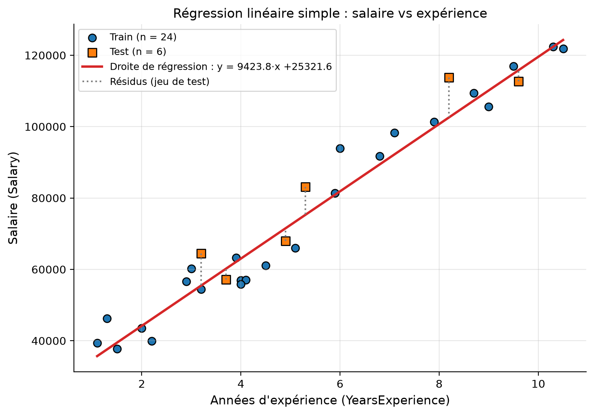
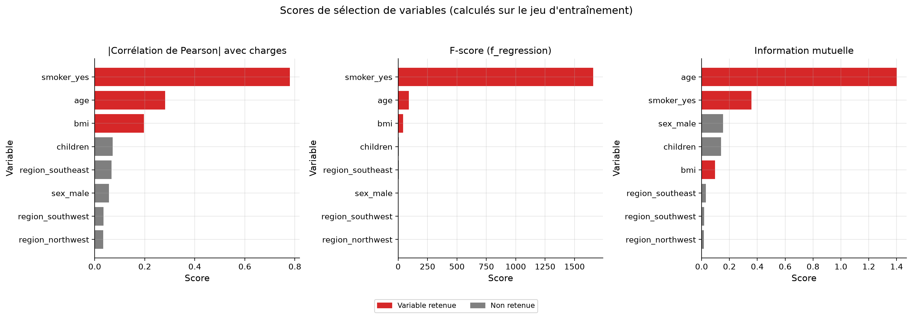
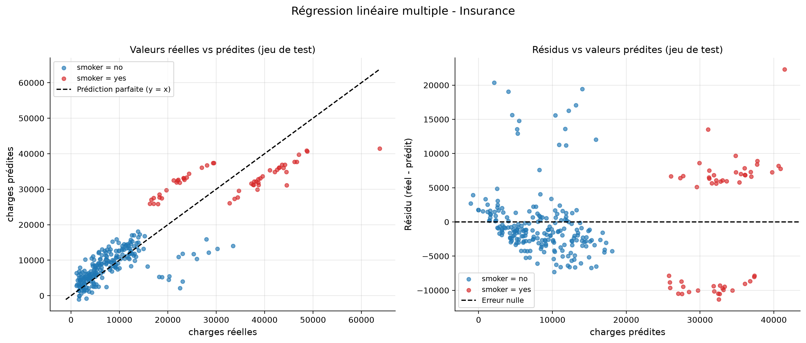
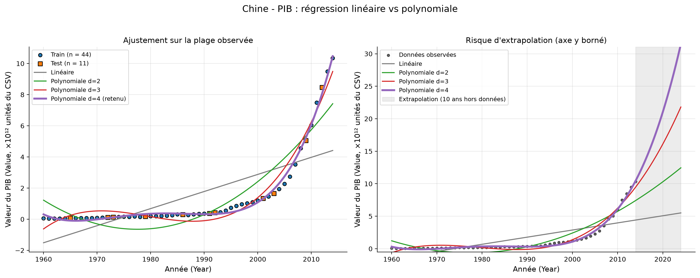

# Atelier 1 — Régression (Machine Learning, LSI S3, FST Tanger)

Pipeline reproductible de régression linéaire simple, multiple et polynomiale
(Python, pandas, scikit-learn, matplotlib) avec un **rapport LaTeX dont chaque chiffre est
injecté automatiquement** depuis les exécutions : aucune valeur n'est recopiée à la main.

Atelier encadré par Pr. El Aachak Lotfi — Université Abdelmalek Essaadi, Faculté des Sciences
et Techniques de Tanger, Département Génie Informatique, cycle ingénieur LSI S3.

## Table des matières
1. [Objectifs](#objectifs)
2. [Arborescence](#arborescence)
3. [Quickstart](#quickstart)
4. [Correspondance énoncé → sorties](#correspondance-énoncé--sorties)
5. [Méthodologie (le pourquoi de chaque décision)](#méthodologie)
6. [Résultats](#résultats)
7. [Aperçu des figures](#aperçu-des-figures)
8. [Reproductibilité](#reproductibilité)
9. [Limitations](#limitations)
10. [Rapport PDF et build](#rapport-pdf-et-build)
11. [Auteur](#auteur)

## Objectifs
- Pratiquer la régression linéaire simple (Salary), multiple (Insurance) et polynomiale (China GDP).
- Évaluer chaque modèle avec MSE, RMSE et MAE, et interpréter les erreurs dans l'unité de la cible.
- Livrer un dépôt exécutable de bout en bout : `make setup && make data && make all && make report`.

## Arborescence
```text
src/            utils.py, part1_eda.py, part2_simple_regression.py,
                part3_multiple_regression.py, part4_polynomial_regression.py
data/           README.md + raw/ (CSV non versionnés)
results/        metrics (*.json), prédictions (*.csv), logs/partN.txt
report/         main.tex, Rapport_Atelier1_Regression_Ouhaddou_Sara.pdf (version finale),
                figures/ (PNG 200 dpi), generated/ (snippets LaTeX), screenshots/
docs/           SCREENSHOTS.md (checklist des captures)
Makefile, requirements.txt, .gitignore
```

## Quickstart
```bash
make setup                                   # venv + dépendances
export KAGGLE_USERNAME="..."                 # identifiants en variables d'environnement uniquement
read -rsp "Kaggle key: " KAGGLE_KEY; echo; export KAGGLE_KEY
make data                                    # ou copier les CSV dans data/raw/ (voir data/README.md)
make all                                     # part1..part4
make report                                  # -> report/build/main.pdf
```
Chaque partie s'exécute aussi seule depuis la racine : `make part2` ou `python src/part2_simple_regression.py`.
Sous Windows, utilise WSL (le Makefile suppose bash).

## Correspondance énoncé → sorties

| Énoncé | Script | Figure(s) dans `report/figures/` | Sortie terminal / fichiers |
|---|---|---|---|
| P1.1 Exploration pandas | `part1_eda.py` | — | `results/logs/part1.txt` (head, info, NaN), `results/part1_summary.json` |
| P1.2 Résumé statistique | `part1_eda.py` | — | `results/part1_*_describe.csv`, `report/generated/part1_*_describe.tex` |
| P1.3 Nuage Experience/Salary | `part1_eda.py` | `p1_salary_scatter.png` | corrélation de Pearson dans le log |
| P1.4 scatter_matrix Insurance | `part1_eda.py` | `p1_insurance_scatter_matrix.png` | — |
| P2.1–2.2 Entraînement, prédictions | `part2_simple_regression.py` | — | `results/part2_predictions.csv`, `part2.txt` |
| P2.3 Graphe | `part2_simple_regression.py` | `p2_regression_plot.png` | — |
| P2.4 MSE/RMSE/MAE | `part2_simple_regression.py` | — | `results/part2_metrics.json`, `report/generated/part2_metrics.tex` |
| P3.1 EDA | `part3_multiple_regression.py` | `p3_eda_overview.png`, `p3_corr_heatmap.png` | skewness, corrélations dans `part3.txt` |
| P3.2 Sélection de 3 variables | `part3_multiple_regression.py` | `p3_feature_scores.png` | `results/part3_feature_selection.json`, `part3_feature_selection.tex` |
| P3.3 Standardisation | `part3_multiple_regression.py` | — | moyenne/écart-type du scaler dans `part3.txt`, `part3_metrics.json` |
| P3.4–3.5 Entraînement, prédictions | `part3_multiple_regression.py` | — | coefficients (`part3_coefficients.tex`), `results/part3_predictions.csv` |
| P3.6 Graphe | `part3_multiple_regression.py` | `p3_actual_vs_predicted.png` | — |
| P3.7 MSE/RMSE/MAE | `part3_multiple_regression.py` | — | `results/part3_metrics.json`, `report/generated/part3_metrics.tex` |
| P4.1–4.2 Linéaire + polynomial, prédictions | `part4_polynomial_regression.py` | — | `results/part4_test_predictions.csv` |
| P4.3 Graphe des deux modèles | `part4_polynomial_regression.py` | `p4_comparison.png` (ajustement + extrapolation) | — |
| P4.4 MSE/RMSE/MAE | `part4_polynomial_regression.py` | — | `results/part4_metrics.json`, `report/generated/part4_metrics.tex` |

## Méthodologie
- **Convention de split unique** : `test_size=0.2`, `random_state=42` partout. Un seul réglage évite de comparer des modèles sur des découpages différents.
- **Colonnes vérifiées, jamais supposées** : les scripts affichent `df.columns` et s'arrêtent si une colonne attendue manque. Les noms attendus (`YearsExperience`/`Salary`, `age…charges`, `Year`/`Value`) sont des hypothèses à contrôler.
- **Partie 2** : une seule variable explicative, donc une droite que l'on peut tracer avec ses résidus. RMSE et MAE sont comparés à la moyenne et à l'écart-type du salaire, avec un baseline « prédire la moyenne » comme point de repère.
- **Partie 3 — encodage** : one-hot avec `drop_first=True`, pour éviter la colinéarité parfaite entre modalités (dummy-variable trap).
- **Partie 3 — sélection** : trois critères (|corrélation|, `SelectKBest(f_regression)`, information mutuelle). Les scores sont calculés sur le **train uniquement**, pour que le test n'influence pas le choix. Règle explicite : les 3 variables au meilleur rang moyen. Les critères linéaires (corrélation, F) et non linéaire (information mutuelle) se complètent.
- **Partie 3 — standardisation** : `StandardScaler` fitté sur le train seulement (aucun data leakage). Il met les coefficients dans une unité comparable et centre l'intercept ; le min-max serait dominé par les valeurs extrêmes de `bmi`. Les prédictions OLS sont invariantes par changement d'échelle affine : le script le vérifie (`scaling_invariance_max_abs_diff`).
- **Partie 4** : degrés 2, 3 et 4 comparés sur le test. Règle de choix : le plus petit degré dont le RMSE test est à moins de 5 % du meilleur (parcimonie, contre l'overfitting). `Year` est standardisée dans le pipeline car `Year**4` vaut environ 1e13. La figure montre aussi 10 ans d'extrapolation : un polynôme peut diverger hors des données.
- **Métriques** : MSE, RMSE, MAE demandées ; R² ajouté comme complément. Train et test sont toujours rapportés côte à côte pour juger overfitting / underfitting.
- **Injection des résultats** : chaque script écrit `report/generated/partN_*.tex` (tableaux booktabs + `\renewcommand`) ; `main.tex` les lit via `\input`. Les phrases d'interprétation qui dépendent des chiffres sont marquées `[À COMPLÉTER APRÈS EXÉCUTION: …]`.

## Résultats
Valeurs du **jeu de test**, reprises de `results/part2_metrics.json`, `part3_metrics.json` et `part4_metrics.json` (`test_size=0.2`, `random_state=42`). Les erreurs sont dans l'unité de chaque cible ; les valeurs de l'ordre de 1e12 (Partie 4) sont dans l'unité du CSV China GDP.

| Partie | Modèle | MSE | RMSE | MAE | R² |
|---|---|---|---|---|---|
| 2 | Régression linéaire simple (Salary) | 4.983e7 | 7,059.04 | 6,286.45 | 0.9024 |
| 3 | Régression linéaire multiple (Insurance, 3 variables) | 3.451e7 | 5,874.76 | 4,260.56 | 0.7777 |
| 4 | Linéaire (China GDP) | 2.910e24 | 1.706e12 | 1.341e12 | 0.5578 |
| 4 | Polynomiale d=2 | 9.108e23 | 9.543e11 | 7.505e11 | 0.8616 |
| 4 | Polynomiale d=3 | 2.112e23 | 4.596e11 | 4.169e11 | 0.9679 |
| 4 | Polynomiale d=4 | 3.128e22 | 1.769e11 | 1.332e11 | 0.9952 |

Degré polynomial retenu (Partie 4) : **4** (règle de parcimonie : plus petit degré dont la RMSE de test est à moins de 5 % de la meilleure ; seul d=4 est éligible).

Variables retenues (Partie 3, rang moyen sur corrélation, F et information mutuelle) : `smoker_yes`, `age`, `bmi`.

## Aperçu des figures
Figures produites par les scripts (`make all`), reprises dans le rapport ; les autres sont dans `report/figures/`.

| Partie 2 — régression simple | Partie 3 — sélection de variables |
|:---:|:---:|
|  |  |

| Partie 3 — valeurs réelles vs prédites | Partie 4 — linéaire vs polynomial |
|:---:|:---:|
|  |  |

## Reproductibilité
- `random_state=42` pour le split et l'information mutuelle ; versions des librairies en bornes minimales dans `requirements.txt` (relever `pip freeze` pour un gel exact).
- Les datasets ne sont pas versionnés ; les identifiants Kaggle ne sont jamais écrits dans un fichier ni dans git. `results/part3_predictions.csv` (lignes de test dérivées du dataset Insurance) est volontairement ignoré par git.
- Toutes les sorties (figures, JSON, snippets LaTeX, logs) sont régénérées par `make all`; `make clean` les supprime.

## Limitations
- Un seul découpage train/test : les métriques dépendent de ce split (pas de validation croisée).
- Le degré polynomial est choisi sur le jeu de test, comme le demande l'énoncé ; l'erreur test du modèle retenu est donc légèrement optimiste.
- Le split de la Partie 4 est aléatoire sur une série temporelle ; un découpage chronologique serait plus exigeant. L'extrapolation hors de la plage d'années n'est pas fiable.
- Les noms de colonnes et de fichiers des datasets sont des hypothèses ; si un dataset diffère, adapter `DATASETS` dans `src/utils.py`.
- Le miroir IBM du CSV China GDP dans `utils.py` est à vérifier ; le téléchargement manuel reste la référence.

## Rapport PDF et build
Le rapport final est versionné : [`report/Rapport_Atelier1_Regression_Ouhaddou_Sara.pdf`](report/Rapport_Atelier1_Regression_Ouhaddou_Sara.pdf) (aussi joint à la release `v1.0.0`). C'est une copie figée : en cas de modification du code ou du `.tex`, relancer `make all && make report` puis recopier le PDF.

```bash
make report        # latexmk -pdf -interaction=nonstopmode -outdir=build main.tex (dans report/)
cp report/build/main.pdf report/Rapport_Atelier1_Regression_Ouhaddou_Sara.pdf
```
Le PDF compilé est produit dans `report/build/main.pdf` (dossier ignoré par git). Les captures optionnelles placées dans `report/screenshots/` sont incluses automatiquement (voir `docs/SCREENSHOTS.md`).

## Auteur
**Sara Ouhaddou** — Ingénierie LSI (Software and Intelligent Systems), FST Tanger — [github.com/ouhaddousara](https://github.com/ouhaddousara)
